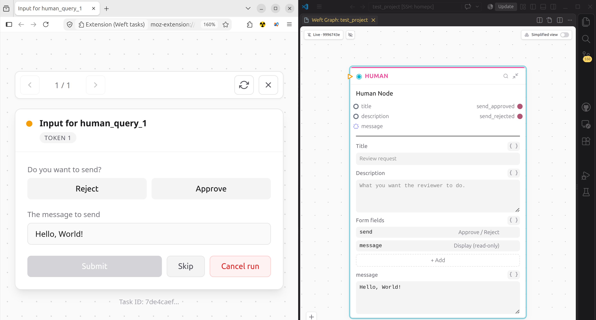

# Putting a person in the loop

A node can stop and ask somebody a question. The run parks, the worker shuts
down, and when the answer arrives a fresh worker picks the run back up exactly
where it was. Waiting costs nothing, so a program can sit on a question for a
week, as long as the run can pause (for when it cannot, go and read
[when a run cannot pause](../language/triggers-and-routes.md#when-a-run-cannot-pause)).

This is `HumanQuery`, and it looks like this:

```weft
review = HumanQuery {
  title: "Send this answer?"
  fields: [
    { "kind": "display", "key": "question" },
    { "kind": "display", "key": "answer" },
    { "kind": "approve_reject", "key": "send" }
  ]
  question: ask.content
  answer: draft.answer
}
```

The `fields` list builds both the form and the node's ports. A `display` field
takes a value in and shows it to the reader. An `approve_reject` field gives
you two boolean outputs, `sendApproved` and `sendRejected`, so you gate what
happens next on the one you want:

```weft
# ask is the BaileyReceive trigger the message came in on, whatsapp its BaileyBridge
reply = BaileySend {
  _should_flow: review.sendApproved
  bridge: whatsapp.bridge
  to: ask.chatId
  message: draft.answer
}
```

## Where the question shows up

Not in VS Code. The graph shows you that something is waiting, with a cyan ring
round the box and the word `Suspended` in its body, and the inspector says
`Waiting for input...`. Answering happens in the **Weft tasks** browser
extension you installed earlier.

Give the extension a way in by minting a token from your project folder:

```bash
weft token mint --name "my laptop"
```

A signal token lets an outside client list a project's waiting nodes and answer
them. The full value is printed once, at mint, and never again, so copy it now.
`--projects` and `--tags` narrow what it can reach, and `weft token ls` and
`weft token revoke <id>` handle the rest.

Open the extension, go to its settings, and add your runtime: its address and
that token. The browser will ask you to allow access to that host, because the
extension holds no permission to reach anything until you give it one.

## What the person sees

One card at a time. Your title, the values you wired into the `display` fields,
and the buttons or boxes your other fields asked for. The primary button says
**Submit** for a question inside a running program, and **Fire** for a trigger
that starts one.

Beside it, **Skip** declines the question: the node that asked ends skipped,
every output of it closes, and the nodes reading them skip in turn while the
rest of the run carries on. **Cancel run** ends the whole run. Neither
shows up on a trigger, which has no question to decline: weft refuses a skip
there.

After a submit the card says `Submitted` and moves to the next one. Back in the
graph, the cyan ring goes green and the rest of your program runs.



## Starting a run from a person

`HumanTrigger` is the same form pointed the other way: instead of parking a run
that already exists, it starts a new one when somebody fills it in. It shows up
in the extension under trigger tasks rather than resume tasks, and it only
appears once you have run `weft activate`, because a trigger is only listening
after you arm it.

For why activating is a separate step from running, go and read
[the three lifecycles](../start/lifecycles.md).

## When nobody answers

A parked run waits, with no deadline. `HumanQuery` has no timeout setting and
weft will not invent one, because a question that expires on its own leaves you
with a run that ended for a reason nobody wrote down.

So ending it is a decision somebody makes. The person looking at the card can
press **Cancel run**, and you can run `weft stop <run-id>`. To find the ones
still sitting there:

```bash
weft runs --status waiting_for_input
```

That lists only the runs parked on a wait. `weft runs --status running` lists
them too, beside the ones still working, and the status column tells them
apart.
