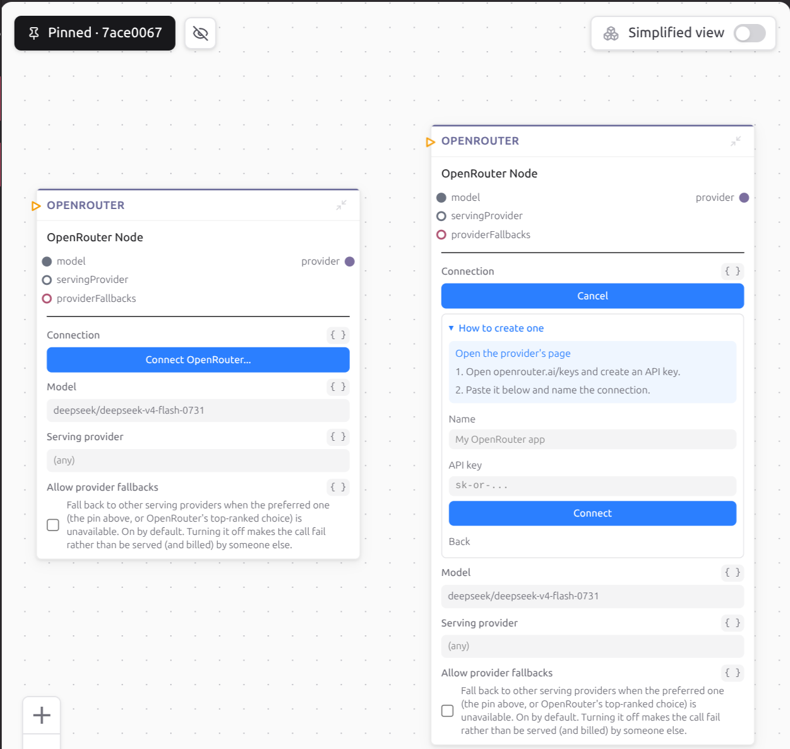

# Connecting an account

A node that sends a Slack message needs a Slack account. You connect it once,
weft keeps the credential, and your program passes around a reference to it
rather than the secret itself.

## Do it in the graph

A node that talks to an outside service has a blue **Connect Slack...** button
in its body, named after whatever service it needs. Until you pick something,
that node will not fold shut: the fold arrow is greyed out, and hovering it
says **Pick a connection first**.

Click it and you get your existing connections for that service, then, under
**+ Add a connection**, the ways to make a new one:

- **Use *App name* (one click)**, one row per application your runtime was
  configured with, each showing the permissions it asks for. Those permissions
  are fixed per application, so you pick an application rather than ticking
  boxes.
- **Use ours (uses your credits)**, when the runtime holds a key for that
  service. This is the row that appears because you filled in
  [`access-apps.json`](../connections/the-apps-file.md) before installing.
- **Your own...**, always. Tick the permissions you want, follow the guide for
  registering an application with that provider, or just paste a key you
  already have.

Sign-in opens your browser for the provider's consent screen and the panel
waits, then flips to a green **Connected as *your name*** with **Change** and
**Disconnect** beside it.



If you take the shared door, weft warns you once that somebody else in the same
workspace using that same application may disconnect you, and that your own
application avoids it.

## Or from the terminal

```bash
weft connect
```

Run it in the project folder, pick the node, and answer the prompts. `weft
connect --list` prints what is already stored and changes nothing. `weft
connect --node account` goes straight to one node. `--disconnect` clears a
node's pick and leaves the stored account alone, and `--forget <id>` deletes
the stored account for good.

Every project on the install can pick any stored connection, so if you keep
two keys for one service, their names are how you tell them apart: the list
shows each one's account and its name. When you connect a new one your own
way, with your own key or your own application, `weft connect` asks for a name
(`--label <name>` answers without asking), and pressing Enter names it after
the service. The editor's **Name** field does the same when you leave it empty.
If you sign in through a shared application, or through the one your project
declares, that application names the connection (a shared key is named after
the service), so nothing is asked and `--label` is refused. A name with the project in it, like
`acme-scraper`, suits a key only that project should use.

## Picked on each install

Which connection a node uses is kept by the install you picked it on, never
written in your `.weft` files. A connection lives in one install, so its id
means nothing on another: your machine and your cloud each have their own
accounts, and each keeps its own pick. If you want a node connected on your
cloud install, run `weft connect --on prod` there (it is the same
walkthrough). A node inside a file you include twice is two nodes, one per
place, and each place gets its own pick.

If you run a program with a node nobody connected on this install, the run
is refused before it starts, naming the node and the `weft connect` that
fixes it. `weft activate` and `weft resync` check every node of the program
the same way before any trigger moves, so a missing pick is caught there and
not at the first call. Forgetting a stored connection takes every pick of it
with it.

A pick is kept under the node's full address, and the file a node is written
in is part of that address. So if you move `chat.weft` into a `studio/`
folder, the node that was `chat.send.agent` is now `studio.chat.send.agent`,
and its pick stays behind under the old name. weft never guesses where a node
went. If a node in the program can hold every field the old one kept (the same
field, picked the same way, on the install or `@instance_filled`, and
connecting to the same service; extra fields are fine) and nothing is stored
for those fields there yet, activating refuses and names both addresses:

```
'chat.send.agent' has connections or values stored on this install and is no
longer in the program; did you move it to 'studio.chat.send.agent'?
`weft connect --move chat.send.agent studio.chat.send.agent` carries them across
```

`weft connect --move <old> <new>` carries the program's pick and every
instance's values for that node across in one go. It refuses if nothing is
stored at the old address, if the new address is not in the program this
install last built, if the new node already has something stored, or if it
cannot hold every field the old one kept.

If a build refuses a line like `account: {"id": "...", "identity": "..."}`
with "that was the old way of connecting a node", the connection was written
into the source by an older weft. Erase that line and connect the node again;
the install keeps the pick from then on.

## Never paste a key into a node's field

Values written into a node travel through the journal and render in the
inspector as plain text, where anybody who can open the project reads them.
That is also true of anything you paste into a chat with your assistant.

A connection is the other thing: the secret goes into weft's own store, and
what moves along the wire is a small reference with no secret in it.

```json
{
  "__weft_access__": {
    "accessId": "connection-id",
    "service": "slack",
    "identity": "Acme Corp",
    "requiresPermissions": ["chat:write"]
  }
}
```

When a node consumes it, the runtime adds what that node needs onto it. When
the node opens it, a missing stored value is refused, and so is a missing permission on a verified
connection, rather than failing halfway through a call.

## What weft can tell you before a call fails

Providers differ in how honest they are. Some state exactly what they granted,
and weft blocks a node whose permission is missing. Others only confirm the
credential is alive, or say nothing at all until a real call comes back
refused, and then weft lets the call through because it has nothing to block
on.

So a bad credential sometimes shows up for the first time when a node tries to
use it. For the whole picture, go and read
[how connections work](../connections/how-they-work.md).

Next, [put a person in the loop](a-person-in-the-loop.md).
